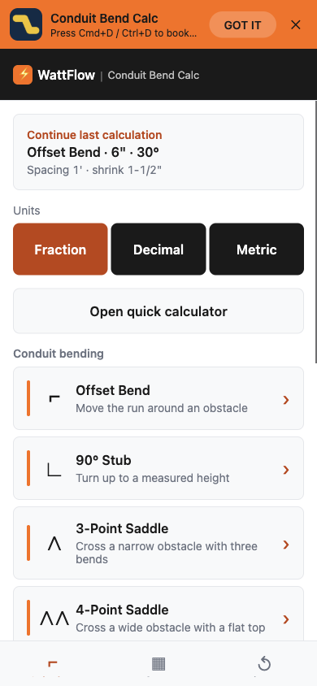
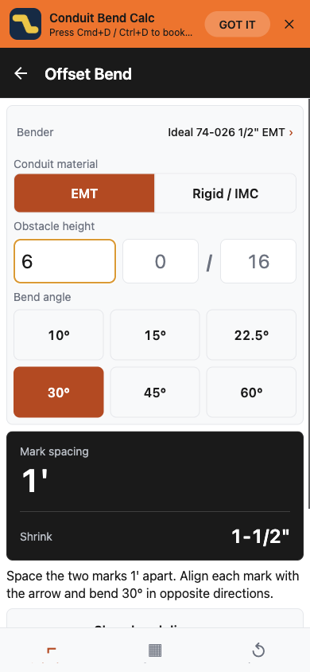
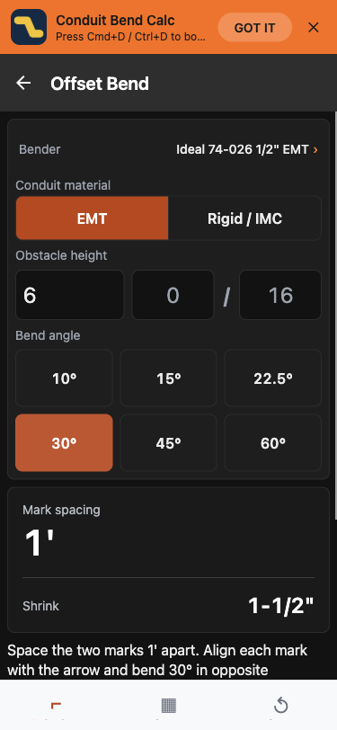
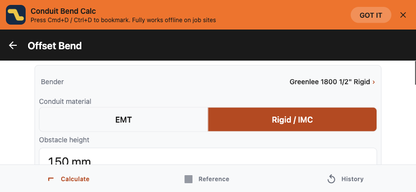

# T79 现场计算体验验收

验收日期：2026-11-14。

## 源码基线

- 以 `feature/firebase` 的 `a38669a` 为起点，整合已获取的 `origin/main`（`a1594dd`，好评引导）。
- 保留 Expo SDK 53 / React 19 / RN 0.79、Firebase、16 KB 页面配置和既有发布配置。
- 上游 `expo-store-review` 对齐本地 Expo SDK 53 的 bundledNativeModules 声明（`~8.1.5`）。没有为本次界面改动增加其他依赖。
- 本次集成提交使用 `T79: 优化现场计算流程和白色按压反馈`，源码和本记录一起提交。

## 交付行为

1. 六类弯管计算器均先显示结果、风险提示，再显示可展开的图解；校准推广放在标记说明之后。
2. 首页按弯管 / 电气 / 我的弯管器分组；快速计算器可展开，避免遮住主要工具入口；显示继续上次计算。
3. 历史携带原单位和弯管器，回填等待档案加载且每次只执行一次。非当前页面不再修改全局弯管器或自动记录计算；离开页面时保存尚未落盘的有效结果。
4. 历史写入和清空按顺序执行；首页订阅最新落盘结果，避免快速返回时显示旧计算。
5. 选中控件为白字，白色按压叠层 / Android 涟漪；控件使用加深橙色，品牌强调色保持原规范。深色模式的次级按钮文字使用可读的 `primaryText`。
6. Pro 只保留一个首页校准入口，购买前说明试弯、测量与工具准备；历史文案明确为本机最近 20 条，免费查看 5 条、Pro 查看全部并导出，不承诺无限历史。

## 自动验证

- `npm run typecheck`：通过。
- `npm test`：332 项通过，0 失败。
- 新回归覆盖：选中及白色按压叠层后的文字对比度、公制历史往返、损坏记录防护、并发保存、清空后新计算的顺序。
- 正常控件对比度约 5.18:1，8% 白色叠层后约 4.57:1。
- `offload-run node node_modules/expo/bin/cli export --platform web --output-dir .git/t79-web`：成功；临时 Web 产物验收后删除。
- Web 导出有既有 Android `google-services.json` 缺失配置提示；本次没有生成该敏感配置，也没有执行原生预构建。

## 浏览器行为验证

使用本机临时静态服务器和 Ego Browser 验证实际导出的应用。

- 390×844：Offset 输入 6 英寸、30°，间距 1 英尺与 Shrink 1-1/2 英寸完整出现在同一首屏；图解默认收起，展开后出现示意图。
- 首页继续计算：切换到 Metric 后继续英制历史，恢复英制分数输入及对应结果。
- 快速返回：输入 8 英寸后直接返回首页，最近计算更新为 8 英寸、间距 1 英尺 4 英寸、Shrink 2 英寸。
- 公制与材质：150 mm / 30° / Greenlee 1800 1/2 Rigid，返回首页改选 Fraction，再继续计算，恢复 150 mm、公制结果 300 mm / 37.5 mm 和 Rigid 弯管器。
- 375×812，深色与减少动态效果媒体条件：选中文字实际计算样式为 `rgb(255,255,255)`，底色为 `rgb(194,65,12)`；按住 30° 按钮捕获白色反馈。
- 844×390 横屏：文档宽度与视口均为 844，无横向溢出；通过纵向滚动访问后续结果。

## 截图

### 首页与继续计算

### 两项关键结果同屏

### 深色模式按压中

### 横屏

## 验证边界

本次完成源码与 Web 行为验证，没有构建或安装 Android / iOS App，没有推送、部署或发布。Android 原生涟漪、真机键盘、系统最大字体、读屏、飞行模式和实际购买未在本次实测；截图不代表完整可访问性认证。既有未保存单位的历史按原英制默认兼容，无法从旧裸数字中可靠推断原单位。
